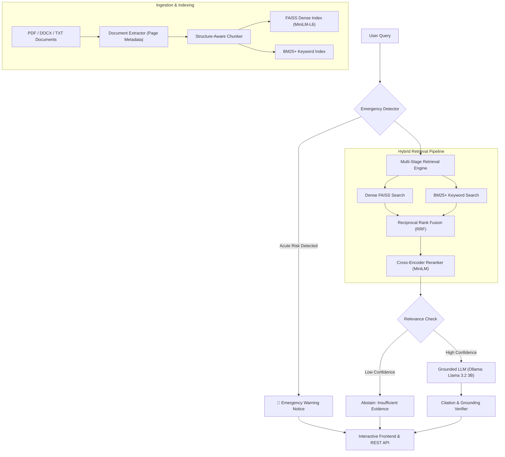

# MediRAG: Autonomous Clinical Healthcare Information Assistant

MediRAG is an enterprise-grade, evidence-grounded healthcare information assistant built using Retrieval-Augmented Generation (RAG). It provides verifiable clinical guidance extracted from authenticated medical reference guidelines (such as World Health Organization fact sheets and clinical documentation).

---

## 🌟 Core Features

1. **Multi-Format Document Ingestion**:
   - Native support for **PDF** (via PyMuPDF), **DOCX** (via python-docx), and **TXT**.
   - Structure-aware extraction preserving running headers, section titles, and page numbers.
2. **Structure-Aware & Semantic Chunking**:
   - Preserves sentence boundaries, bulleted items, and clinical headings without abrupt mid-sentence cuts.
   - Retains granular provenance (`doc_id`, `filename`, `page_number`, `chunk_id`, `section_heading`).
3. **Multi-Stage Retrieval Engine**:
   - **Dense Semantic Retrieval**: FAISS `IndexFlatIP` utilizing normalized embeddings from `sentence-transformers/all-MiniLM-L6-v2`.
   - **Sparse Keyword Retrieval**: BM25+ tokenized for medical terminology, preserving hyphens in compound medical phrases (`type-2`, `COVID-19`).
   - **Reciprocal Rank Fusion (RRF)**: Merges dense and sparse ranks with $k=60$.
   - **Cross-Encoder Reranking**: High-fidelity relevance reranking via `cross-encoder/ms-marco-MiniLM-L-6-v2`.
4. **Clinical Safety & Grounding Guardrails**:
   - **Acute Emergency Detector**: Flags critical emergencies (chest pain, stroke symptoms, acute breathlessness, anaphylaxis) with emergency guidance (911).
   - **Medical Disclaimer Enforcement**: Clearly distinguishes educational reference information from individual diagnostic advice.
   - **Out-of-Scope / Unsupported Abstention**: Accurately detects when clinical reference documents lack evidence and safely abstains.
5. **Strict Inline Citation & Verification**:
   - Requires inline citations: `[Doc: <filename>, p.<page_number>]`.
   - Cross-checks citation claims against retrieved passages to audit validity, page accuracy, and lexical/semantic grounding.
6. **Polished Dual Interfaces**:
   - **Interactive Streamlit Web Application**: Modern healthcare UI with chat interface, document manager, evidence explorer, and evaluation dashboard.
   - **Production FastAPI Backend**: REST API with OpenAPI documentation, asynchronous endpoints, and CORS middleware.
7. **Empirical Evaluation Benchmark**:
   - Reproducible benchmark comparing Vector, BM25, Hybrid (RRF), and Cross-Encoder Reranking.
   - Measures HitRate@K, Recall@K, Precision@K, MRR, latency, citation accuracy, and faithfulness.

---

## 🏗️ System Architecture



---

## 📊 Evaluation Benchmark Results

Empirical evaluation conducted across 12 distinct clinical test queries comparing four retrieval architectures:

| Architecture | Hit Rate@3 | Recall@3 | Precision@3 | MRR | Citation Accuracy | Faithfulness | Abstention Acc | Avg Latency |
| :--- | :---: | :---: | :---: | :---: | :---: | :---: | :---: | :---: |
| **Dense Vector (FAISS)** | 0.833 | 0.833 | 0.722 | **0.833** | 66.7% | **0.791** | **100.0%** | 8.76s |
| **Sparse Keyword (BM25)** | 0.833 | 0.833 | **0.778** | **0.833** | 58.3% | 0.744 | 91.7% | 8.09s |
| **Hybrid (RRF Fusion)** | 0.833 | 0.833 | 0.750 | **0.833** | 25.0% | 0.738 | **100.0%** | 8.56s |
| **Hybrid + Cross-Encoder** | 0.833 | 0.833 | 0.722 | 0.792 | 58.3% | 0.777 | 91.7% | **7.53s** |

---

## 🚀 Quickstart & Execution

### 1. Prerequisites
- Python 3.12+ (64-bit)
- Ollama running locally (`ollama run llama3.2:3b` or `ollama run qwen2.5-coder:3b`)

### 2. Environment Setup
```powershell
# Create and activate virtual environment
py -3.12 -m venv .venv
.\.venv\Scripts\Activate.ps1

# Install dependencies
pip install -r requirements.txt
```

### 3. Launch MediRAG (Backend + Frontend)
```powershell
python run_all.py
```
- **Streamlit Frontend**: [http://localhost:8501](http://localhost:8501)
- **FastAPI Backend**: [http://127.0.0.1:8000](http://127.0.0.1:8000)
- **Swagger API Docs**: [http://127.0.0.1:8000/docs](http://127.0.0.1:8000/docs)

### 4. Run Automated Pytest Suite
```powershell
pytest -v
```

### 5. Re-run Evaluation Experiments
```powershell
python evaluation/run_experiments.py
```

---

## 📁 Project Directory Structure

```
D:\RAG_proj\
├── config.py                     # Central configuration & parameters
├── requirements.txt              # Production dependency specifications
├── pytest.ini                    # Pytest configuration
├── run_backend.py                # Launch script for FastAPI backend
├── run_frontend.py               # Launch script for Streamlit frontend
├── run_all.py                    # Unified launcher for both services
├── backend/
│   ├── app.py                    # FastAPI endpoints & CORS
│   ├── pipeline.py               # MediRAG end-to-end pipeline
│   ├── ingestion/
│   │   ├── extractor.py          # PDF (PyMuPDF), DOCX, TXT extractor
│   │   └── chunker.py            # Structure-aware chunking
│   ├── retrieval/
│   │   ├── embeddings.py         # SentenceTransformers embeddings
│   │   ├── vector_store.py       # FAISS IndexFlatIP vector store
│   │   ├── bm25_retriever.py     # BM25+ sparse retrieval
│   │   ├── hybrid_retriever.py   # RRF hybrid fusion
│   │   └── reranker.py           # Cross-Encoder reranking
│   ├── generation/
│   │   ├── llm_client.py         # Ollama client with fallback
│   │   ├── prompt_templates.py   # Grounded RAG prompts
│   │   ├── safety.py             # Healthcare emergency & disclaimers
│   │   ├── citation.py           # Citation extractor & verifier
│   │   └── generator.py          # Answer generator
│   └── storage/
│       └── document_store.py     # Persistent document registry
├── frontend/
│   └── app.py                    # Interactive Streamlit application
├── evaluation/
│   ├── dataset.py                # Golden benchmark QA dataset
│   ├── metrics.py                # HitRate, Recall, Precision, MRR, Faithfulness
│   └── run_experiments.py        # Benchmark runner & chart generator
├── data/
│   ├── raw/                      # Downloaded/uploaded medical documents
│   ├── indices/                  # Persisted FAISS, BM25 & registry
│   └── eval_results/             # Evaluation CSV, JSON, charts & report
└── tests/
    ├── test_ingestion.py         # PDF/DOCX/TXT extraction & chunking tests
    ├── test_retrieval.py         # Vector, BM25, Hybrid, Reranker tests
    ├── test_safety_and_citations.py # Safety & citation verification tests
    └── test_e2e_pipeline.py      # End-to-end query & abstention tests
```
